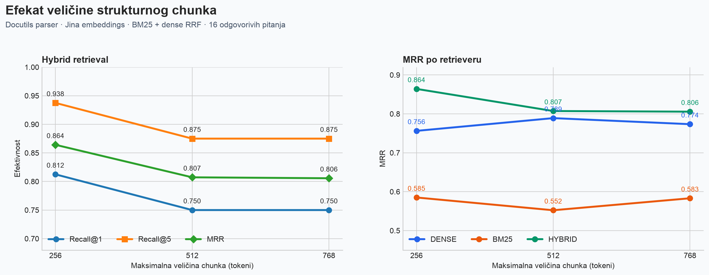

# RAG over Python Documentation

A local Retrieval-Augmented Generation system for questions about Python documentation, with dense retrieval, BM25, and Reciprocal Rank Fusion (RRF). The accompanying bachelor's thesis evaluates retrieval methods and structural chunking configurations.

**Author:** Nemanja Zelic  
**Institution:** University of Belgrade, School of Electrical Engineering  
**Supervisor:** prof. dr Marko Mišić  
**Thesis:** *Realizacija RAG sistema i evaluacija pretrage nad dokumentacijom programskog jezika Python* (September 2026, Serbian).

[Read the thesis (PDF)](docs/Diplomski_rad_RAG.pdf) · [Defense slides](docs/Odbrana_diplomskog_RAG_Python_2%20%281%29.pptx) · [Original project notes](START_HERE.md)

## System overview

The pipeline retrieves passages from CPython documentation and Python Enhancement Proposals (PEPs), combines search rankings, and generates an answer with source links. It can refuse a question when the best dense retrieval score is below a configured threshold.

```text
CPython documentation + Python PEPs
                 |
       document processing and chunking
                 |
       +---------+---------+
       |                   |
 FAISS dense search   SQLite FTS5 BM25
       +---------+---------+
                 |
       Reciprocal Rank Fusion
                 |
       answerability threshold
                 |
       Qwen2.5 answer + source links
```

- **Corpus:** 1,316 source files from pinned revisions of CPython and Python PEPs.
- **Embeddings:** `jinaai/jina-embeddings-v2-small-en`, executed with ONNX Runtime; 512-dimensional, L2-normalized vectors.
- **Dense retrieval:** exact FAISS `IndexFlatIP` search.
- **Lexical retrieval:** SQLite FTS5 BM25.
- **Fusion:** RRF with `k = 60`.
- **Generation:** `Qwen/Qwen2.5-0.5B-Instruct`, using the first two retrieved passages.
- **Experiments:** Docutils structural chunking with target size/overlap configurations of 256/32, 512/64, and 768/96 tokens.

## Selected results

The development set contains 20 questions: 16 answerable questions used for retrieval metrics and four marked as unanswerable. Relevance labels identify documents, rather than exact evidence passages.

The table summarizes hybrid retrieval for the three structural configurations. Success@k denotes the fraction of answerable questions with a labeled relevant document among the first k results. The original JSON files name these fields `recall@1` and `recall@5`.

| Target size / overlap | Chunks | Success@1 | Success@5 | MRR@60 | Retrieval p50 |
|---|---:|---:|---:|---:|---:|
| 256 / 32 | 36,165 | 0.8125 | 0.9375 | 0.8642 | 48.86 ms |
| 512 / 64 | 25,103 | 0.7500 | 0.8750 | 0.8073 | 42.87 ms |
| 768 / 96 | 22,371 | 0.7500 | 0.8750 | 0.8057 | 39.72 ms |

Within these experiments, 256/32 achieves the highest hybrid MRR, with the largest index and highest recorded retrieval latency. The latency figures exclude query embedding and answer generation. The recorded environment and package versions are in [the original inventory](thesis/data/system_inventory.json).



These results describe a small development set. They do not establish general superiority, statistical significance, or the accuracy of generated answers. The thesis includes case studies where an answer is incorrect despite useful retrieved context. The `ask` command uses the reference index; it does not select the structural experimental indexes.

See [saved results](thesis/data/chunk_size_results.json), [the experiment matrix](thesis/data/experiment_matrix.csv), and thesis Chapters 5-7 for the protocol and limitations.

## Running the original project

The commands below follow the original project. The launcher uses `.venv/bin/python`, so these instructions target macOS/Linux. Native Windows execution requires adapting the launcher; this repository preserves the submitted source without that change.

The archived environment records Python 3.14.3 on macOS ARM64. Exact dependency versions are preserved in [requirements.txt](requirements.txt). Other environments and a full clean installation have not been validated as part of repository preparation. Setup downloads source documents and model weights and requires network access and sufficient local storage.

Run from the repository root:

```bash
python3 rag.py setup
python3 rag.py ask "How many spaces does PEP 8 recommend?" --json
python3 rag.py evaluate --json
python3 rag.py experiment
python3 rag.py verify
```

`setup` creates a virtual environment, installs dependencies, and builds the reference artifacts. `experiment` creates/evaluates the structural variants. `verify` checks the available reference artifacts and runs the unit tests; it does not certify that a clean rebuild reproduces the historical thesis results.

The existing logic tests can also be run without downloading the corpus or models:

```bash
python3 -m unittest discover -s tests -v
```

### Reproduction boundary

The Git repository includes code, questions, frozen summary results, figures, bibliography, the thesis PDF, and the defense presentation. Local `data/`, downloaded models, generated indexes, the original virtual environment, and the 1.8 GB ZIP archive are excluded. They remain in the original Desktop folder.

The historical reference artifacts were created with an earlier processing pipeline, preserved under [thesis/evidence/legacy_pipeline](thesis/evidence/legacy_pipeline). The active `build.py` uses a simpler fixed token window when rebuilding from an empty `data/` directory. A fresh build therefore must not be assumed to reproduce the historical reference numbers exactly. Comparing that reference with structural configurations changes more than chunk size. The original [project notes](START_HERE.md) and [evidence notes](thesis/evidence/README.md) explain this distinction.

The PDF also references a separate electronic supplement. Files absent from the supplied Desktop package have not been reconstructed or added here. Some original planning notes describe an earlier stage of the thesis; consult the PDF for the submitted narrative.

## Repository structure

```text
rag.py                 Retrieval, fusion, generation, evaluation, and CLI
build.py               Source downloads, reference chunking, and indexing
requirements.txt       Original pinned dependencies
evaluation/            Structural chunking experiments and question set
verification/          Reference artifact integrity checks
tests/                 Existing unit tests
thesis/data/           Saved metrics, inventory, and original checksums
thesis/figures/        Experiment figures in PNG and SVG
thesis/evidence/       Archived processing code and provenance notes
docs/                  Thesis PDF and defense presentation
START_HERE.md          Original project orientation notes (Serbian)
```

## Sources

Source repository and model revisions are retained in the code and [system inventory](thesis/data/system_inventory.json). The thesis bibliography is also available in [BibTeX format](thesis/references.bib). Downloaded third-party documentation and model weights are not bundled in this repository.
